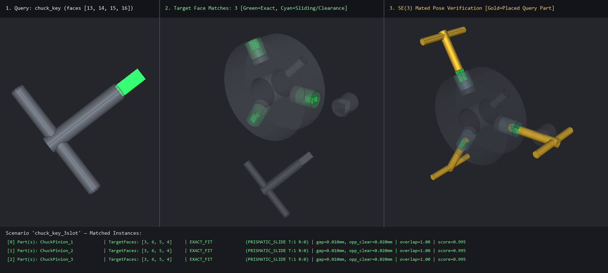
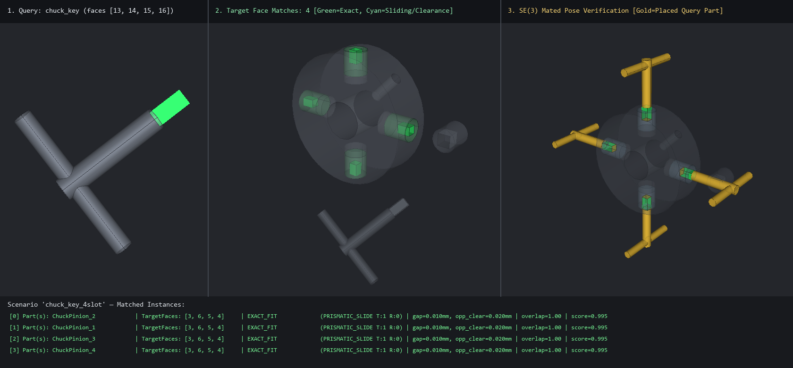
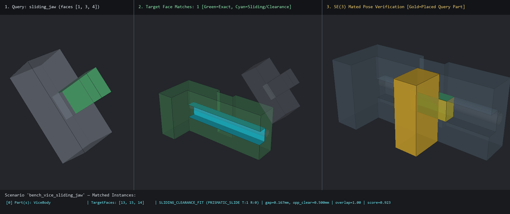
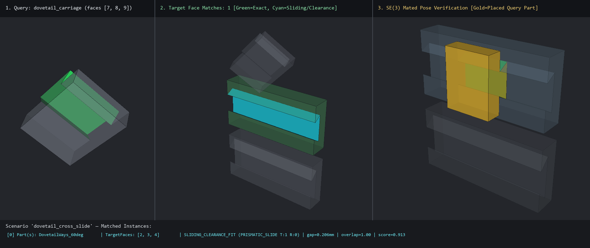
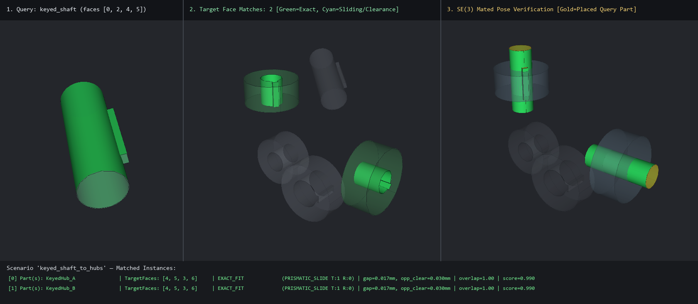
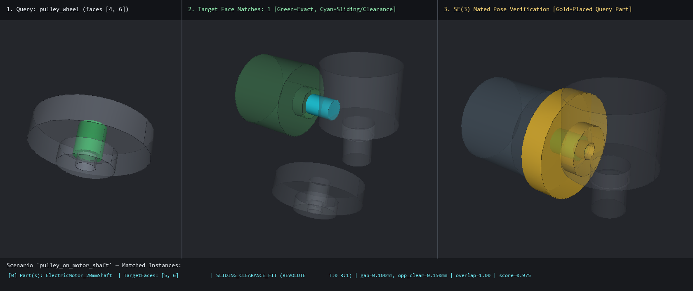
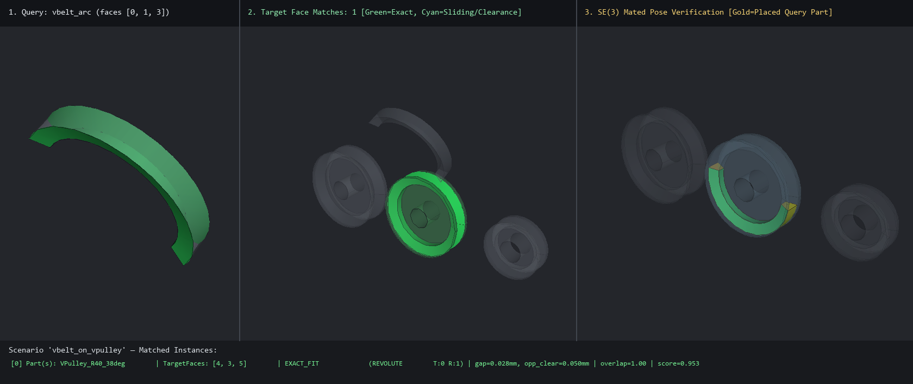
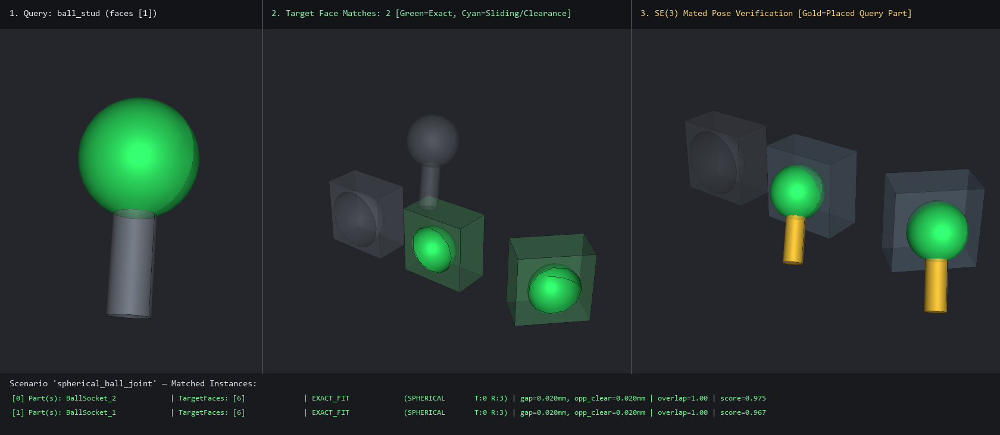
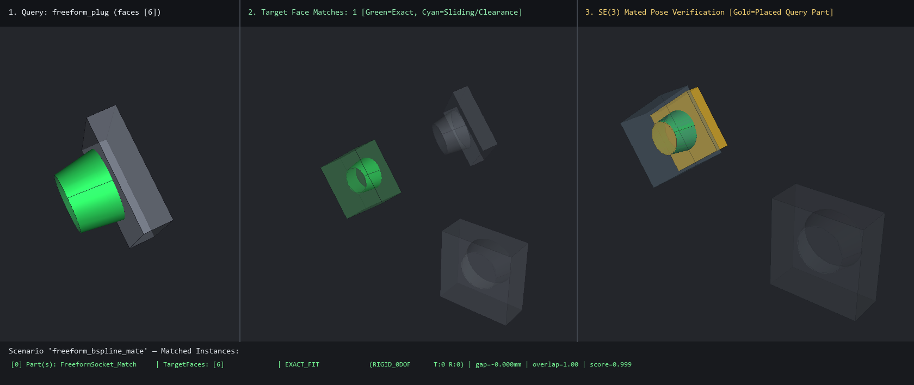

# Technical Write-Up & Evaluation Outputs: SE(3)-Invariant B-Rep Auto-Mating

- **GitHub Repository:** https://github.com/Adityakk9031/auto-mating-assembly
- **Live Interactive 3D Web UI (Vercel):** https://auto-mating-assembly.vercel.app

---

## 1. What Properties / Semantics We Matched On and Why

We match directly on **Open CASCADE B-Rep topology and analytic surface geometry** (`cadquery-ocp` / OCCT 8.0) combined with interior-classified UV surface samples (`BRepClass_FaceClassifier`), in three stages:

### 1.1 Single-Face Intrinsic Semantics
- **Surface Class & Material Sense:** Every `TopoDS_Face` is classified as `PLANE`, `CYLINDER`, `CONE`, `SPHERE`, `TORUS`, or `FREEFORM` (`BSpline` / `Bezier`), with its outward normal corrected for `TopAbs_REVERSED`. Curved surfaces are assigned a radial sense (`+1` = convex shaft/ball/taper, `-1` = concave bore/socket/groove) and must have opposite sense (`q.sense * t.sense == -1`) to mate.
- **Scale-Aware Metric Compatibility:** Cylinders and spheres must satisfy radial clearance `c = R_concave - R_convex` within `[-0.15 mm, min(2.5 mm, max(0.35 mm, 0.08 * D))]`. Cones must match half-angle within `3°` with overlapping radial spans `[r_min, r_max]`.
- *Why:* B-Rep analytic primitives give exact radii, axes, cone half-angles, and outward material directions without mesh discretization noise.

### 1.2 Pairwise $SE(3)$-Invariant Group Constraints
- **Normal / Axis Angles with Mating Parity:** Under a mating transform $T = (R, \mathbf{t}) \in SE(3)$, planar outward normals invert ($R\mathbf{n}_q = -\mathbf{n}_t$) while canonical cone widening axes preserve sign ($R\mathbf{a}_q = +\mathbf{a}_t$). Pairwise dot products between faces in the selected group must match the target group within `4°`.
- **Signed Parallel-Plane Opposing Clearance ($g = d_t + d_q$):** For parallel opposing planes ($\mathbf{n}_1 \cdot \mathbf{n}_2 \approx -1$), $d_q = (\mathbf{o}_{q_2} - \mathbf{o}_{q_1}) \cdot \mathbf{n}_{q_1} = -W_{\text{key}}$ (normals point away from each other through solid material) and $d_t = (\mathbf{o}_{t_2} - \mathbf{o}_{t_1}) \cdot \mathbf{n}_{t_1} = +W_{\text{slot}}$ (normals point toward each other across empty slot). Their sum $g = d_t + d_q = W_{\text{slot}} - W_{\text{key}}$ is $SE(3)$-invariant, directly measures slot clearance, and immediately rejects male-to-male ($g = -2W$) or wrong-width slots.
- **Non-Parallel Plane Half-Space Overlap & 3D Chirality:** For non-parallel planes (e.g., `90°` square key corners or `60°` dovetails), we check signed half-space projection intervals of each face's sample points onto the other's normal and enforce $SO(3)$ triple chirality ($\det(-R) = -1$), eliminating convex-to-convex and mirror-image false positives.
- **Axis-to-Axis & Plane-to-Axis Distances:** Shortest 3D line distance between cylinder/cone axes and signed offset from cylinder axis to keyway/shoulder planes.

### 1.3 Constrained $SE(3)$ Pose Solver, Solid Non-Penetration & Fit Classification
- **Pose ($R, \mathbf{t}$):** Rotation $R \in SO(3)$ is solved via Kabsch SVD (with 1-DOF spin optimization for single-axis groups and 3D PCA + point-normal ICP for freeform B-splines). Translation $\mathbf{t} \in \mathbb{R}^3$ is solved via rank-revealing SVD least squares, centering clearance gaps and seating 1-DOF sliding axes above blind pocket floors.
- **Trimmed Overlap & Full-Body Collision:** Verifies exact trimmed face overlap (`BRepExtrema_DistShapeShape >= 45%`) and probes interior points ($\mathbf{p}_{\text{surf}} - 0.20\text{ mm}\cdot\mathbf{n}_{\text{surf}}$) on both selected and unselected query-part faces against the target solid (`BRepClass3d_SolidClassifier`) to reject upside-down $D_4$ key orientations. Adjacent seam-split target faces (e.g., two `180°` half-cylinder bore faces) are merged into a unified match.
- **Exact vs. Sliding/Clearance Fit Distinction:**
  - `INTERFERENCE_FIT`: `min_gap < -0.01 mm` (down to `-0.15 mm`).
  - `EXACT_FIT`: invariant opposing clearance and max face mean gap `<= 0.08 mm` (faces nearly coincide).
  - `SLIDING_CLEARANCE_FIT`: controlled positive gap (`> 0.08 mm` up to $c_{\text{eff}}$), where opposing faces stay parallel/coaxial with a controlled clearance gap and never simultaneously coincide.
  - Kinematic pair DOFs (`RIGID_0DOF`, `PRISMATIC_SLIDE`, `REVOLUTE`, `CYLINDRICAL`, `PLANAR`, `SPHERICAL`) are derived from the rank and nullspace of the translation and rotation constraint matrices.

---

## 2. What Breaks

1. **Query-Side Seam Splits Against Unsplit Target Faces:** Co-surface sibling merging currently unifies split faces on the target part (e.g., a 1-face query shaft matching a 2-face seam-split target bore). If the user selects two half-cylinder faces on a seam-split query shaft against an unsplit 1-face target bore, the 1-to-1 injective matcher needs query-side pre-merging.
2. **Third-Party Housing Collisions:** Solid collision checks the query part body against the matched target part(s), preventing upside-down insertions into the target part itself, but does not sweep the full query part against unrelated surrounding parts in the assembly.
3. **Large Face Selections ($k > 15$) on $10{,}000+$ Face Assemblies:** Backtracking search runs in `0.3s–3.9s` for typical feature groups (`1–8` faces), but selecting `15+` planar faces on a very large assembly without hash-indexed anchor pairs can hit combinatorial slowdown.

---

## 3. What I'd Do With Another Week

1. **Symmetric Co-Surface B-Rep Face Pre-Merging:** Merge adjacent co-planar, co-cylindrical, co-conical, and co-spherical faces on both query and target shapes into canonical logical surfaces prior to graph matching.
2. **Full-Assembly BVH Collision & 1-DOF Insertion-Ray Sweeps:** Check the entire transformed query solid against a bounding-volume hierarchy of all assembly parts and sweep along unconstrained kinematic sliding axes to verify an unobstructed physical assembly path.
3. **Curvature Histograms + Point-to-Plane Gauss-Newton ICP for Multi-Patch Freeform Surfaces:** Replace PCA+Kabsch initialization on freeform NURBS patches with FPFH descriptors and full $6\times 6$ twist-wrench Jacobian rank analysis.
4. **Geometric Hashing for Large Assemblies:** Index target face pairs into a quantized hash table keyed by `(surface_type_1, surface_type_2, angle_bin, signed_distance_bin)` for sub-second lookup on `500+` part machine-tool assemblies.

---

## 4. Output: Highlighted Renders & Matched Face IDs for Each Test Assembly

### 1. `chuck_key_3slot` (3-Jaw Lathe Chuck + T-Handle Chuck Key)
- **Query Selection:** `chuck_key.stp`, 4 square drive tip planes — Face IDs `[13, 14, 15, 16]`
- **Matches Found (3 instances — all `EXACT_FIT`, `PRISMATIC_SLIDE (T:1, R:0)`):**
  - Match `#0`: Part `ChuckPinion_1` | Target Local Face IDs `[3, 6, 5, 4]` (Global IDs `[15, 18, 17, 16]`) | Mean Gap `0.010 mm` | Opposing Clearance `0.020 mm` | Overlap `100%`
  - Match `#1`: Part `ChuckPinion_2` | Target Local Face IDs `[3, 6, 5, 4]` (Global IDs `[23, 26, 25, 24]`) | Mean Gap `0.010 mm` | Opposing Clearance `0.020 mm` | Overlap `100%`
  - Match `#2`: Part `ChuckPinion_3` | Target Local Face IDs `[3, 6, 5, 4]` (Global IDs `[31, 34, 33, 32]`) | Mean Gap `0.010 mm` | Opposing Clearance `0.020 mm` | Overlap `100%`

### 2. `chuck_key_4slot` (4-Jaw Lathe Chuck + T-Handle Chuck Key)
- **Query Selection:** `chuck_key.stp`, 4 square drive tip planes — Face IDs `[13, 14, 15, 16]`
- **Matches Found (4 instances — all `EXACT_FIT`, `PRISMATIC_SLIDE (T:1, R:0)`):**
  - Match `#0`: Part `ChuckPinion_2` | Target Local Face IDs `[3, 6, 5, 4]` (Global IDs `[25, 28, 27, 26]`) | Mean Gap `0.010 mm` | Opposing Clearance `0.020 mm`
  - Match `#1`: Part `ChuckPinion_1` | Target Local Face IDs `[3, 6, 5, 4]` (Global IDs `[17, 20, 19, 18]`) | Mean Gap `0.010 mm` | Opposing Clearance `0.020 mm`
  - Match `#2`: Part `ChuckPinion_3` | Target Local Face IDs `[3, 6, 5, 4]` (Global IDs `[33, 36, 35, 34]`) | Mean Gap `0.010 mm` | Opposing Clearance `0.020 mm`
  - Match `#3`: Part `ChuckPinion_4` | Target Local Face IDs `[3, 6, 5, 4]` (Global IDs `[41, 44, 43, 42]`) | Mean Gap `0.010 mm` | Opposing Clearance `0.020 mm`

### 3. `bench_vice_sliding_jaw` (Bench Vice Sliding Jaw on Vice Body Guide Ways)
- **Query Selection:** `sliding_jaw.stp`, 3 guide tongue sliding planes — Face IDs `[1, 3, 4]`
- **Matches Found (1 instance — `SLIDING_CLEARANCE_FIT`, `PRISMATIC_SLIDE (T:1, R:0)`):**
  - Match `#0`: Part `ViceBody` | Target Local Face IDs `[13, 15, 14]` (Global IDs `[13, 15, 14]`) | Mean Gap `0.167 mm` | Opposing Clearance `0.500 mm` | Overlap `100%`

### 4. `dovetail_cross_slide` (60° Machine-Tool Dovetail Carriage on Dovetail Ways)
- **Query Selection:** `dovetail_carriage.stp`, 2 angled `60°` dovetail cheek planes + bottom guide plane — Face IDs `[7, 8, 9]`
- **Matches Found (1 instance — `SLIDING_CLEARANCE_FIT`, `PRISMATIC_SLIDE (T:1, R:0)`):**
  - Match `#0`: Part `DovetailWays_60deg` | Target Local Face IDs `[2, 3, 4]` (Global IDs `[2, 3, 4]`) | Mean Gap `0.206 mm` | Normal Error `0.14°` | Overlap `100%`

### 5. `keyed_shaft_to_hubs` (Keyed Motor Shaft into Multiple Keyed Hubs)
- **Query Selection:** `keyed_shaft.stp`, outer shaft cylinder + 3 parallel key faces — Face IDs `[0, 2, 4, 5]`
- **Matches Found (2 instances — both `EXACT_FIT`, `PRISMATIC_SLIDE (T:1, R:0)`):**
  - Match `#0`: Part `KeyedHub_A` | Target Local Face IDs `[4, 5, 3, 6]` (Global IDs `[4, 5, 3, 6]`) | Mean Gap `0.017 mm` | Opposing Clearance `0.030 mm`
  - Match `#1`: Part `KeyedHub_B` | Target Local Face IDs `[4, 5, 3, 6]` (Global IDs `[11, 12, 10, 13]`) | Mean Gap `0.017 mm` | Opposing Clearance `0.030 mm`

### 6. `pulley_on_motor_shaft` (Pulley Wheel Bore + Shoulder onto Motor Shaft)
- **Query Selection:** `pulley_wheel.stp`, concave bore cylinder (`R=10.0 mm`) + axial stop shoulder plane — Face IDs `[4, 6]`
- **Matches Found (1 instance — `SLIDING_CLEARANCE_FIT`, `REVOLUTE (T:0, R:1)`):**
  - Match `#0`: Part `ElectricMotor_20mmShaft` | Target Local Face IDs `[5, 6]` (Global IDs `[5, 6]`) | Mean Gap `0.100 mm` | Opposing Radial Clearance `0.150 mm`

### 7. `vbelt_on_vpulley` (180° V-Belt Inner Conical Flanks + Inner Cylinder upon V-Pulley Groove)
- **Query Selection:** `vbelt_arc.stp`, 2 conical V-flanks (`19°` half-angle) + inner cylinder — Face IDs `[0, 1, 3]`
- **Matches Found (1 instance — `EXACT_FIT`, `REVOLUTE (T:0, R:1)`):**
  - Match `#0`: Part `VPulley_R40_38deg` | Target Local Face IDs `[4, 3, 5]` (Global IDs `[4, 3, 5]`) | Mean Gap `0.028 mm` | Opposing Radial Clearance `0.050 mm`

### 8. `spherical_ball_joint` (Spherical Ball Stud into Multiple Ball Sockets)
- **Query Selection:** `ball_stud.stp`, convex spherical head (`R=14.0 mm`) — Face ID `[1]`
- **Matches Found (2 instances — both `EXACT_FIT`, `SPHERICAL (T:0, R:3)`):**
  - Match `#0`: Part `BallSocket_2` | Target Local Face ID `[6]` (Global ID `[13]`) | Mean Gap `0.020 mm` | Radial Clearance `0.020 mm`
  - Match `#1`: Part `BallSocket_1` | Target Local Face ID `[6]` (Global ID `[6]`) | Mean Gap `0.020 mm` | Radial Clearance `0.020 mm`

### 9. `freeform_bspline_mate` (Freeform Lofted B-Spline Cam Plug into Freeform Pocket)
- **Query Selection:** `freeform_plug.stp`, closed B-spline cam loft surface — Face ID `[6]`
- **Matches Found (1 instance — `EXACT_FIT`, `RIGID_0DOF (T:0, R:0)`):**
  - Match `#0`: Part `FreeformSocket_Match` | Target Local Face ID `[6]` (Global ID `[6]`) | Mean Gap `0.000 mm` | Overlap `100%`

